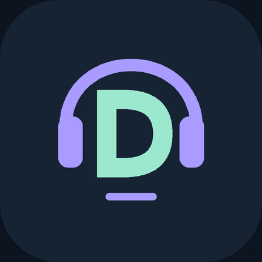

<p align="center"></p>
<h1 align="center">Drover for Android</h1>
<p align="center">One button. Local processing. Discord only.</p>
<p align="center"><a href="README.ar.md">العربية</a> · <a href="LICENSE">MIT license</a> · <a href="https://github.com/7e59/Drover-Android/actions">Builds</a></p>

An experimental Android app for local Discord networking and voice connection testing. Tap Start, approve Android's VPN prompt, then join your Discord call. No manual server IP, root access, account token, or external VPN server is required.

## Download

[Download Drover 0.8.1 APK](https://github.com/7e59/Drover-Android/raw/refs/heads/main/downloads/Drover-0.8.1.apk). Android 10+ · ARM64 · experimental, development-signed build.

Install as an update over an existing build signed with the same key. Other signing identities, including temporary GitHub Actions debug keys, cannot update that installation without uninstalling it. Private signing keys are not included.

## Features

- Simple Arabic interface with one Start/Stop button and collapsible diagnostics.
- Per-app routing restricted to the official `com.discord` package.
- TCP/UDP and IPv4/IPv6 forwarding using Android VpnService and a vendored native engine.
- Automatically recognizes Discord's UDP discovery messages and applies an optional experimental prelude.
- Local-only authenticated SOCKS5 relay, protected outbound sockets, bounded in-memory logs.
- Explicit shutdown from the app or notification; no microphone or account permissions.

## Quick start

1. Install the official Discord app and this APK.
2. Stop any other VPN. Do not enable always-on/lockdown for this experimental app.
3. Tap Start and approve the Android VPN permission.
4. Rejoin your Discord voice channel. Confirm that audio works in both directions.
5. If a call fails, copy diagnostics after the attempt; redact server IPs before sharing publicly.

Only one ordinary VPN can be active on Android. Successful general UDP tests or a matching discovery reply do not prove that voice works. Behavior depends on the network and Discord version. The original tester reported that version 0.3 worked; this is not a guarantee for every device/network. Later interface/stop changes still require device testing.

## Build

Requirements: JDK 17+ supported by Gradle 9.1 (CI uses JDK 21), Android SDK platform 36, Build Tools 35.0.0, NDK 28.2.13676358. All native sources are vendored; no submodule initialization is necessary.

```sh
git clone https://github.com/7e59/Drover-Android.git
cd Drover-Android
chmod +x gradlew
./gradlew assembleDebug testDebugUnitTest lintDebug
```

On Windows use `gradlew.bat`. Set `ANDROID_HOME` or configure the SDK in an untracked `local.properties`. Output: `app/build/outputs/apk/debug/app-debug.apk`. CI uploads a debug APK and test/lint reports; its signing key is temporary, not a stable production release key.

## Architecture and privacy

Discord → per-app Android TUN → hev-socks5-tunnel/lwIP → authenticated loopback SOCKS5 → direct destination sockets.

The app does not decrypt TLS, read Discord storage, collect account tokens, record audio, or upload telemetry. Diagnostics keep up to 100 lines in RAM and can contain the actual voice server address. Local relay credentials are generated per run, stored in an app-private configuration excluded from backup, and removed on normal shutdown. A crash can leave that local configuration until overwritten on the next start.

See [architecture](docs/ARCHITECTURE.md), [contributing](CONTRIBUTING.md), and [security reporting](SECURITY.md).

## Attribution and license

Original Android code: MIT. Vendored dependencies retain their own MIT/BSD licenses; see [third-party notices](THIRD_PARTY_NOTICES.md) and the in-app licenses screen. Exact native revisions are recorded in `app/src/main/jni/hev/SOURCE-PINS.txt`.

Inspired by [Discord Drover for Windows](https://github.com/hdrover/discord-drover). This is an independent Android project, not an official port or an affiliated Discord product. No upstream Drover DLL, source implementation, DDetours code or custom packet is distributed. The Windows repository had no clear top-level license at the reviewed commit, so its implementation was not copied.

Use only where authorized. Local VPN processing does not itself grant permission to bypass regulated service restrictions.
